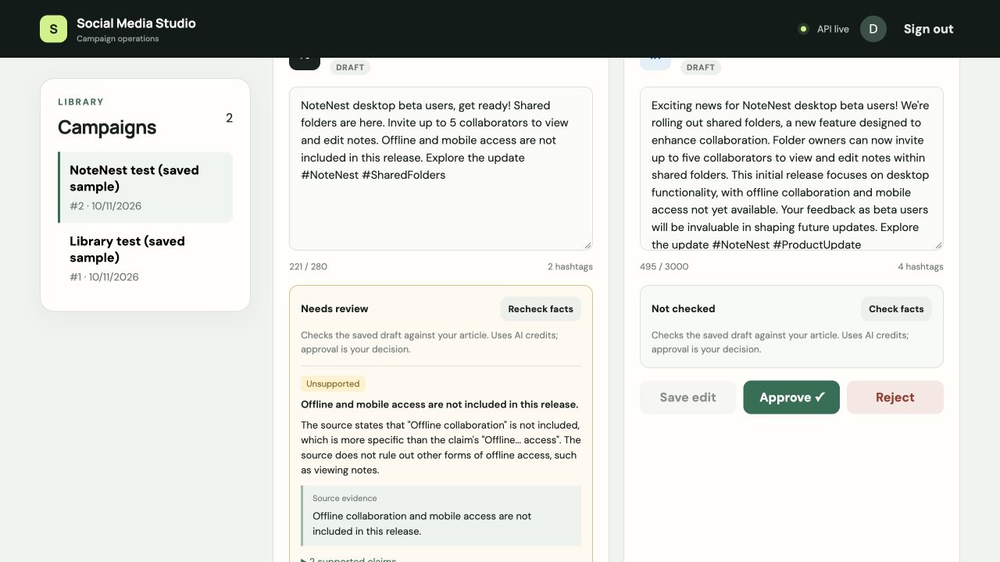

# Dashboard fact-check integration

Added the on-demand Check facts / Recheck facts action to each saved variant. The shared judge now lives in `app/services/factuality.py`; evaluation scripts retain compatibility imports. The API stores every attempt, exact source/draft snapshots, hashes, model/version metadata and complete judge output in `fact_checks`.

Results display Needs review, No issues detected, Unknown/no factual claims, Evaluation failed, or Outdated check, with claim reasons, evidence and available cost. Unsaved edits disable checking and approval; saved edits and source changes invalidate the previous check by hash. Existing manual approval remains available after a completed check, including when it flags issues.

Verification:

- 66 pytest tests passed. New API cases cover persisted findings, owner isolation, unknown results, failed provider calls, edits during checks, source/draft staleness, duplicate processing checks and interrupted-check recovery.
- Frontend production build passed.
- Migration 0007 upgrade/downgrade passed against an isolated SQLite schema at revision 0006; resulting schema matches ORM metadata. Full PostgreSQL migration SQL rendered successfully. A live PostgreSQL migration was not run.
- Browser verification: signed into local demo, checked the saved NoteNest X sample through the actual button, observed Needs review with the offline-access scope finding and source evidence. Reported cost was approximately $0.0138. Reload preserved the result. Editing the text showed Outdated check and disabled Recheck facts and approval until saved; reverted the unsaved verification edit afterward.

The local preview is running at http://localhost:5173 with a persistent SQLite database outside `/tmp`. Its two campaigns are explicitly labeled saved samples recreated from the user's pasted drafts; they are not newly generated outputs. The existing full migration chain targets PostgreSQL, so preview tables were initialized from ORM metadata.

Model interpretation still requires human review; clean results are not proof of correctness. Partial-stage failure usage is not fully captured by the judge's failure records, and missing cost is unknown. Workspace aggregate AI metrics are now labeled generation metrics, with judge costs displayed separately per draft.

