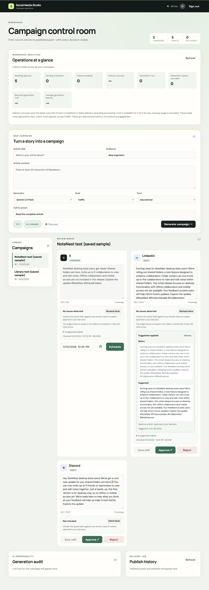

# Optional AI fix suggestion verification

Verified on 2026-10-11 against the local preview.

## Behavior

A current fact check with flagged claims enables Suggest a fix. One model call produces a proposal without editing the saved draft. Before and Suggested show the full texts; Apply suggestion explicitly saves a draft. Applying invalidates the previous check and blocks approval until a successful fresh check completes for the same saved draft and source. Approval remains a human decision, including when a fresh check flags issues. Dismiss hides the proposal without deleting its audit history.

Suggestions store snapshots/hashes, check id, model/prompt version (factuality-fix-v1), proposed content, tokens, cost, latency, failure and application times. Ownership checks, processing uniqueness, interrupted-call recovery and atomic application prevent unauthorized use or overwriting newer edits. Atomic approval also checks the content, draft status and recheck gate.

## Verification

- 78 pytest tests passed, including 12 new cases covering one-call proposals, usage, unchanged originals before application, explicit application, recheck gate, failed/stale rechecks, manual approval, invalid lengths, omitted CTA, unchanged outputs, source/draft/check staleness, concurrent edits/approval, ownership and processing recovery.
- Frontend production build passed.
- Migration 0008 applied to the persistent preview. Schema matches ORM metadata. Downgrade to 0007 and upgrade to head passed on an isolated database copy and preserved all six sample variants. Live PostgreSQL migration was not tested.
- Actual browser test used the already-flagged NoteNest LinkedIn saved sample. The judge had flagged “will be invaluable in shaping future updates.” Suggestion changed it to “will help inform future updates,” preserving the rest of the draft, CTA and hashtags. Original draft remained unchanged until Apply.
- Application saved 482 characters as draft and disabled approval, displaying Outdated check. Recheck returned No issues detected with four supported extracted claims and re-enabled manual approval. Left unapproved. One suggestion call cost approximately $0.0004; the fresh two-stage check cost approximately $0.0191. These are observed costs for this example, not fixed pricing.

This is functional verification of the feature, not a new accuracy benchmark or evidence that every suggested revision is correct. Judge findings can be debatable, and a clean check can miss errors. The optional revision prompt also tells the model to verify findings against the source rather than assume the judge is correct. CTA enforcement is strict when matching generation metadata exists; otherwise preservation is prompt-based.

