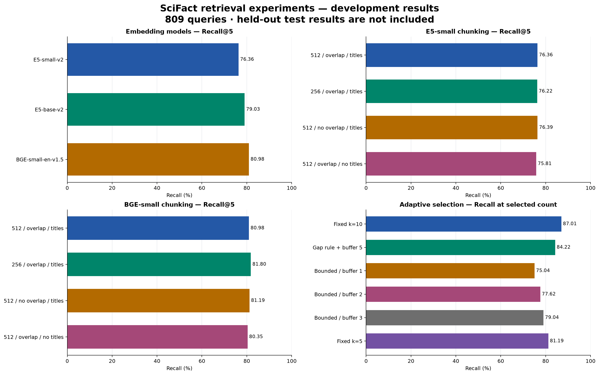
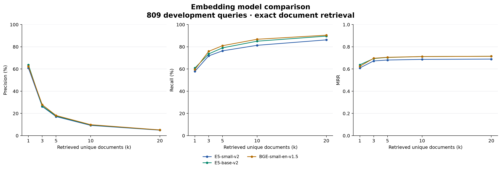
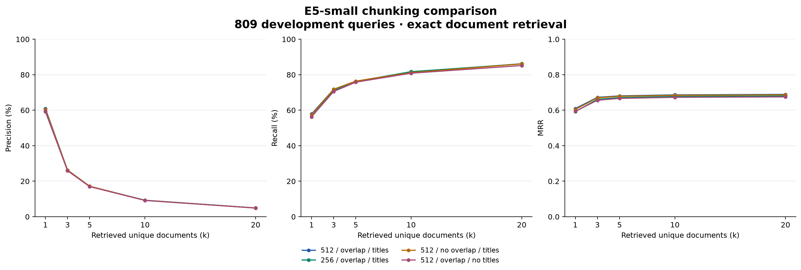
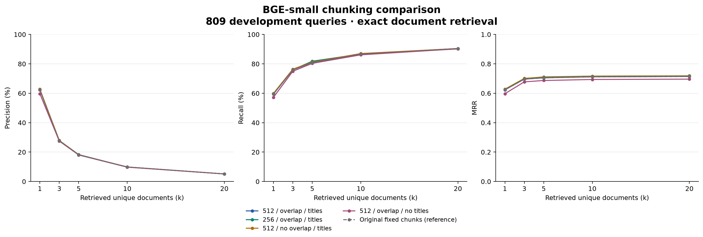
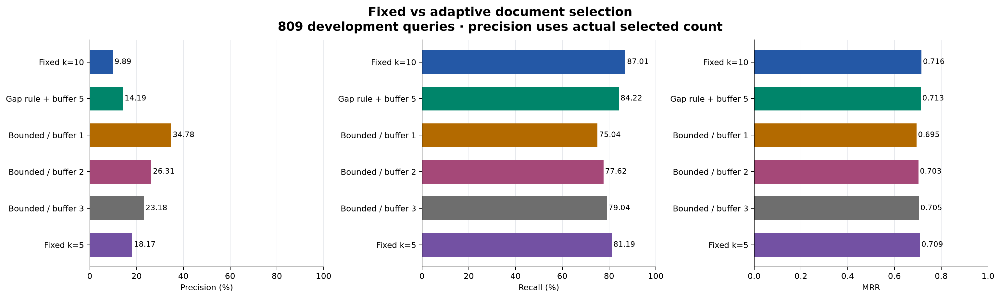
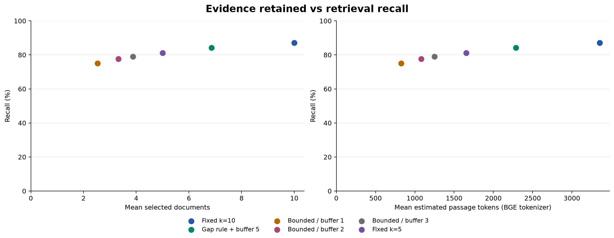
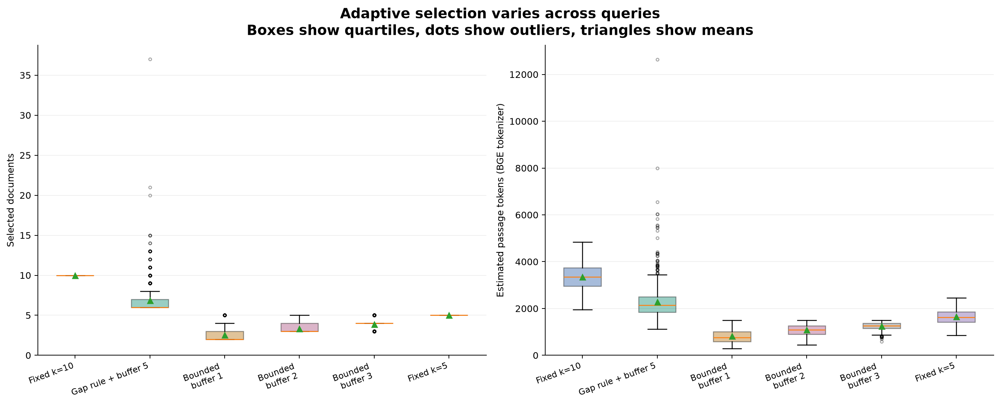
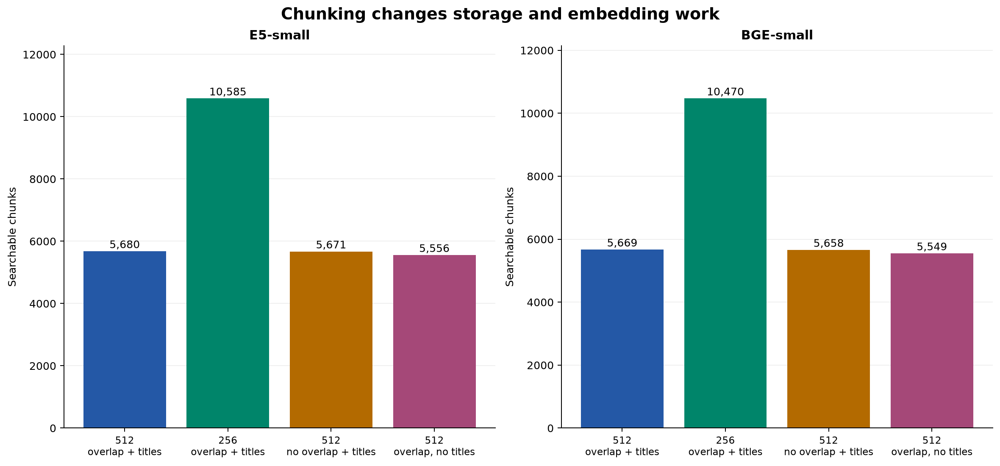

# Retrieval experiment plots

All plots use saved measurements from the same 809 development queries. No new evaluation or model calls were made. PNG is for viewing; SVG is scalable and editable.

## 00 overview

## 01 embedding models vs k

## 02 e5 chunking vs k

## 03 bge chunking vs k

## 04 adaptive metrics

## 05 adaptive context tradeoff

## 06 adaptive distributions

## 07 chunk counts

Precision and recall are percentages; MRR is a score from 0 to 1. Metric axes start at zero. The three k-sweep plots include all five k values. Adaptive precision uses actual selected count, unlike fixed Precision@k. The adaptive token plots use BGE-token estimates including special tokens, not actual generation-model token counts. The distribution plot retains outliers, including the paper-style maximum of 37 documents. BGE native chunking and original fixed-chunk reference are distinguished. Titles/overlap and k can change retrieval evidence volume; none of these plots establishes generated-draft factuality or held-out performance.

Rebuild: `python -m rag.examples.plot_retrieval_results`. Source CSV hashes are recorded in manifest.json.
